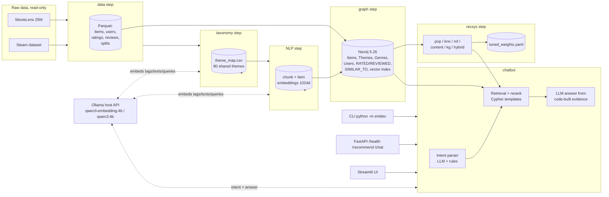

# Entertainment_decision

Hybrid recommender for **movies and games**, backed by a Neo4j knowledge graph, an
embedding layer (local Ollama) and a local-LLM chatbot that explains its recommendations.
A single command, `python -m entdec all --profile tiny`, runs the whole thing end to end.

## Repository structure

```text
Entertainment_decision/
├── README.md
├── pyproject.toml
├── requirements.txt
├── docker-compose.yml
├── .env.example
├── .gitignore
├── config\                         # Configuration: hand-edited settings and generated weights
│   ├── settings.yaml               # Human-maintained profiles and application settings
│   └── tuned_weights.yaml          # Generated validation-tuned recommender and chat weights
├── src\                            # Application source
│   └── entdec\                     # Hybrid movies-and-games recommender package
│       ├── __init__.py              # Package version metadata
│       ├── __main__.py              # Enables python -m entdec CLI execution
│       ├── cli.py                   # build_parser, main - CLI commands and dispatch
│       ├── config.py                # EnvSettings, ProfileConfig, Paths, Config - resolved configuration
│       ├── envcheck.py              # EnvReport, list_ollama_models, run_env_check - dependency health checks
│       ├── logging_setup.py         # setup_logging, get_logger - shared logging configuration
│       ├── pipeline.py              # Step, StepOutcome, build_steps, run - ordered end-to-end pipeline
│       ├── data\                    # Data loading, cleaning, sampling, and time-based splits
│       │   ├── __init__.py          # Data package exports and public loading API
│       │   ├── enrich.py            # cooccurrence_similarity, propagate_tags - game metadata completion
│       │   ├── io.py                # iter_csv_batches, ParquetBatchWriter, read_parquet - batch IO helpers
│       │   ├── movielens.py         # MovieStats, run - MovieLens cleaning, sampling, interactions, and Parquet outputs
│       │   ├── pipeline.py          # build_report, run - both data domains and profile statistics report
│       │   ├── sampling.py          # select_items, select_users - deterministic item and eligible-user sampling
│       │   ├── splits.py            # assign_splits, validate_no_leakage - temporal splits and leakage checks
│       │   └── steam.py             # GameStats, run - Steam cleaning, sampling, reviews, tags, and Parquet outputs
│       ├── taxonomy\                # Canonical genres and shared clustered themes
│       │   ├── __init__.py          # Canonical taxonomy package exports
│       │   ├── genres.py            # normalise_genre, map_genres - canonical genre mapping and audit
│       │   ├── pipeline.py          # build_item_genres, build_movie_themes, run - taxonomy artefacts
│       │   └── themes.py            # ThemeBuildResult, build_theme_map, theme_lookup - shared clustered themes
│       ├── nlp\                     # Item text, chunking, Ollama client, and embeddings
│       │   ├── __init__.py          # NLP package exports
│       │   ├── chunker.py           # Chunk, chunk_text, estimate_tokens - sentence-aware overlapping chunks
│       │   ├── embedder.py          # EmbeddingCache, embed_chunks, run - resumable cached embedding jobs
│       │   ├── ollama_client.py     # OllamaClient, l2_normalize - local HTTP and vector helpers
│       │   └── textdocs.py          # build_movie_document, build_game_document, run - text preparation
│       ├── graph\                   # Neo4j schema, loader, Cypher, similarity, and profile switching
│       │   ├── __init__.py          # Graph package exports for schema and loading
│       │   ├── ids.py               # item_node_id, parse_item_id - namespaced graph entity identifiers
│       │   ├── loader.py            # LoadStats, load_all, verify, run - idempotent graph load and CLI
│       │   ├── neo4j_client.py      # Neo4jClient, compose_up, wait_for_neo4j - connection and Docker helpers
│       │   ├── queries.py           # Template, templates, vector_query_params - parameterized Cypher
│       │   ├── schema.py            # apply_schema, describe_schema, reset_database - constraints and vector index
│       │   ├── similar.py           # top_k_similar, compute_similar_to - offline SIMILAR_TO generation
│       │   └── store.py             # GraphStoreError, use_profile, graph_status - dump and profile switching
│       ├── recsys\                  # Recommender models, evaluation, metrics, and cross-domain reports
│       │   ├── __init__.py          # Recommender package marker
│       │   ├── common.py            # DomainData, ModelOutput, catalogue helpers, and seen-item exclusion
│       │   ├── content.py           # user_profile, model_output - content scoring from liked-item embeddings
│       │   ├── cross_domain.py      # CrossDomainResult, recommend_cross_domain - cross-domain recommendations
│       │   ├── evaluate.py          # Evaluator, tune_chat_weights, run - model validation and reports
│       │   ├── hybrid.py            # HybridModel, tune_weights - normalized weighted scoring and tuning
│       │   ├── itemknn.py           # ItemKNNModel, item_similarity - cosine over user-item interactions
│       │   ├── kg_scoring.py        # kg_scores, user_theme_profile - theme and genre profile scoring
│       │   ├── metrics.py           # recall_at_k, ndcg_at_k, item_coverage - ranking and diversity metrics
│       │   ├── mf.py                # MFModel, fit - implicit matrix factorization training and scoring
│       │   └── popularity.py        # popularity_scores, recommend - positive-train popularity ranking
│       ├── chatbot\                 # Chat CLI and grounded recommendation pipeline
│       │   ├── __init__.py          # Chatbot package marker
│       │   ├── cli.py               # run - interactive chat and one-question command-line entry point
│       │   └── pipeline.py          # ChatPipeline, ChatRanker - retrieval, evidence, reranking, grounded answers
│       ├── llm\                     # Intent parsing, grounded answer generation, and prompts
│       │   ├── __init__.py          # LLM package marker
│       │   ├── generator.py         # parse_answer, generate_answer, fallback_answer - grounded responses
│       │   ├── intent.py            # Intent, parse_intent, rules_intent - validated parsing and fallback
│       │   └── prompts.py            # explain_system, explain_body, explain_retry - qwen3 prompt templates
│       ├── api\                     # FastAPI interface
│       │   ├── __init__.py          # API package marker
│       │   └── main.py              # ChatIn, RecommendIn, create_app, run - HTTP endpoints and server
│       └── ui\                      # Streamlit interface
│           ├── __init__.py          # UI package marker
│           └── app.py               # run, main - Streamlit launcher and application
├── tests\                           # Synthetic unit tests and marked service integrations
│   ├── conftest.py                  # Shared synthetic datasets, config, and filesystem fixtures
│   ├── test_api_main.py             # Unit: FastAPI health, recommend, chat, validation, and degraded states
│   ├── test_chatbot_integration.py  # Integration: chatbot sample queries against live services
│   ├── test_chatbot_intent.py       # Unit: intent parsing, language, fallback, and grounded explanations
│   ├── test_chatbot_pipeline.py     # Unit: candidate retrieval, chat weights, evidence, reranking, and grounding
│   ├── test_cli_parser.py           # Unit: global and subcommand profile argument parsing
│   ├── test_config.py               # Unit: profiles, environment overrides, paths, and persisted weights
│   ├── test_data_enrich.py          # Unit: co-occurrence similarity and tag propagation
│   ├── test_data_loaders.py         # Unit: synthetic MovieLens/Steam parsing, pipelines, and artefacts
│   ├── test_data_sampling.py        # Unit: deterministic item and eligible-user sampling
│   ├── test_data_splits.py          # Unit: temporal splits, leakage checks, and catalog constraints
│   ├── test_envcheck.py             # Unit: environment reports, Ollama responses, and missing dependencies
│   ├── test_graph_integration.py    # Integration: Docker Neo4j counts, vector index, edges, and idempotence
│   ├── test_graph_store.py          # Unit: graph markers, dump metadata, switching rules, and Docker mocks
│   ├── test_graph_unit.py           # Unit: graph IDs, schema, similarity, and parameterized query helpers
│   ├── test_interfaces.py            # Unit: chat CLI output and Streamlit process invocation
│   ├── test_nlp.py                   # Unit: chunking, documents, embeddings, and cache behavior
│   ├── test_pipeline_all.py          # Unit: end-to-end pipeline sequencing and failure behavior
│   ├── test_recsys_chat_tuning.py    # Unit: validation tuning and persistence of anonymous-chat weights
│   ├── test_recsys_cross_domain.py   # Unit: cross-domain matching, recommendations, and evidence
│   ├── test_recsys_metrics.py        # Unit: hand-computed ranking metric cases
│   ├── test_recsys_models.py         # Unit: recommender output shapes and exclusion of seen items
│   └── test_taxonomy.py              # Unit: canonical genres, tag normalization, and clustered themes
├── data\                            # Raw datasets and derived profile data (git-ignored)
│   └── processed\<profile>\         # Contents omitted; theme_map.csv is shared and must be kept
├── reports\                         # Tracked profile reports
│   ├── tiny\                        # Contents omitted
│   └── default\                     # Contents omitted
└── .cache\                          # Git-ignored regenerable embedding and graph caches
    ├── embeddings\                  # Cached text embedding vectors
    ├── tag_embeddings\              # Cached taxonomy tag vectors
    └── graph_dumps\                 # Profile graph dumps
```

The **Where to look** table points to the main implementation surfaces:

| Topic | File |
|---|---|
| Scoring formulas | `src\entdec\recsys\hybrid.py` and `src\entdec\chatbot\pipeline.py` |
| Graph schema | `src\entdec\graph\schema.py` |
| Cypher templates | `src\entdec\graph\queries.py` |
| Prompts | `src\entdec\llm\prompts.py` |
| Tuned weights | `config\tuned_weights.yaml` |
| UI | `src\entdec\ui\app.py` |
| CLI commands | `src\entdec\cli.py` |

`.git/`, `.venv/`, `.cache/`, `data/`, `logs/`, Python bytecode/cache directories,
test/linter caches, generated `*.egg-info/`, and `.env` are git-ignored. They hold
local environments, raw or regenerable data/caches, transient logs, generated
metadata, or secrets. `data\processed\<profile>\` is regenerable; keep the shared
`theme_map.csv` because it is the authoritative taxonomy mapping.
`.cache\embeddings\`, `.cache\tag_embeddings\`, and `.cache\graph_dumps\` are
git-ignored caches. `reports\<profile>\` and `config\tuned_weights.yaml` are
tracked deliverables and should be preserved.

## How it works

One core, four layers, all local:

1. **Data** - MovieLens 25M + Steam recommendations are streamed (never fully loaded),
   sampled/cleaned per profile and split per user by time (last positive = test,
   second-last = validation) into Parquet files.
2. **Taxonomy** - a hand-written canonical genre map (26 genres) plus a clustered theme
   taxonomy: source tags (MovieLens genome + Steam tags) are normalised, alias-merged,
   embedded with `qwen3-embedding:4b` and clustered (Ward on L2-normalised vectors)
   into ~80 themes shared by both domains. `theme_map.csv` maps every raw tag to a theme
   and is authoritative: hand edits are honoured, only `--force` re-clusters.
3. **NLP / embeddings** - per-item documents (genres, top themes/tags, description),
   chunked when they exceed ~400 tokens; vectors come from Ollama `/api/embed` and are
   cached in resumable shards (re-runs embed nothing).
4. **Graph** - everything lands in Neo4j as `:Movie`/`:Game` nodes (with embeddings and
   a cosine vector index), `:Genre`/`:Theme`/`:Platform`/`:User` nodes, interaction edges
   (`RATED`/`REVIEWED`) and offline `SIMILAR_TO` edges (top-10 per item by embedding
   cosine, within and across domains).
5. **Recommenders** - popularity, ItemKNN, MF (implicit ALS), content (embedding
   similarity), KG (theme-profile overlap) and a hybrid that min-max normalises all
   parts and is tuned per domain by grid search on validation. Anonymous chat has a
   separate per-profile/domain weight set tuned from liked-item queries using only
   popularity, content and KG scores.
6. **Chatbot** - intent parsing (`qwen3:4b`, JSON schema with rule fallback) ->
   retrieval (vector index + theme/genre/similar-to Cypher templates + local Parquet
   fallback when Neo4j is down) -> hybrid rerank -> a Vietnamese/English answer phrased
   by the LLM **only** from code-built evidence strings (shared themes/genres,
   similar-to, scores). Interfaces: CLI, FastAPI, Streamlit.



## Requirements

| Component | Verified version |
|-----------|------------------|
| Python | **3.12** (a venv is required; 3.10+ supported, do **not** use 3.15 - the data stack has no wheels yet) |
| Docker + Compose | 29.9.2 / v5.6.1, Neo4j image `neo4j:5.26-community` |
| Ollama | 0.40.11, with `qwen3-embedding:4b` and `qwen3:4b` pulled |
| Hardware the numbers below were measured on | Ryzen 7 6800H, 16 GB RAM, RTX 3050 Ti (4 GB VRAM) |

## Dataset scale: tiny vs default

Counts below are from [tiny data stats](reports/tiny/data_stats.md),
[default data stats](reports/default/data_stats.md), the profile taxonomy reports,
recorded graph counts, and [PROGRESS.md](PROGRESS.md). Interaction rows are the
profile-filtered rows actually stored, not raw dataset totals. “Mapped themes” is
the shared 80-theme map; the graph only contains themes linked to that profile's
items.

| Measure | tiny | default |
|---|---:|---:|
| Movies | 500 | 5,386 |
| Games | 500 | 5,450 |
| Total items / item embeddings | 1,000 | 10,836 |
| Users per domain | 1,000 | 20,000 |
| Users in graph | 2,000 | 40,000 |
| Ratings kept (`RATED`) | 340,619 | 10,640,045 |
| Reviews kept (`REVIEWED`) | 90,411 | 1,894,049 |
| Raw MovieLens `ratings.csv` rows | 25,000,096 | 25,000,096 |
| Raw Steam `recommendations.csv` rows | 41,154,795 | 41,154,795 |
| Train rows (movies + games) | 427,030 (338,619 + 88,411) | 12,454,094 (10,600,045 + 1,854,049) |
| Validation rows (movies + games) | 2,000 (1,000 + 1,000) | 40,000 (20,000 + 20,000) |
| Test rows (movies + games) | 2,000 (1,000 + 1,000) | 40,000 (20,000 + 20,000) |
| Mapped themes / canonical genres | 80 / 26 | 80 / 26 |
| Theme / Genre nodes in graph | 68 / 26 | 77 / 26 |
| `HAS_GENRE` | 3,617 | 36,372 |
| `HAS_THEME` | 7,586 | 80,672 |
| `SIMILAR_TO` | 10,000 | 10,000 |
| `RATED` | 340,619 | 10,640,045 |
| `REVIEWED` | 90,411 | 1,894,048 |
| Graph nodes / relationships | 3,098 / 453,063 | 50,943 / 12,669,835 |
| Graph dump size | 804,878,091 bytes | 870,810,866 bytes |

| Recorded pipeline step | tiny | default |
|---|---:|---:|
| Data | 0.2 s | 3 m 53 s |
| Taxonomy | 1.2 s | 35 s |
| Texts | 0.0 s | 12 s |
| Embeddings | 0.7 s | 22 m 11 s |
| Graph init/load/similar/verify | 28.6 s | 35 m 40 s |
| Recommenders and evaluation | 44.1 s | 1 h 57 m 58 s |
| Cross-domain report | 2.1 s | about 53 s |
| End-to-end run | 78.9 s | 3 h 1 m 27 s |

Tiny timings are from the profile-isolation end-to-end run recorded in
`PROGRESS.md`; default timings are from the full default run in its log and progress
record. A later profile-switch build measured 1,622.9 s for the default graph build
itself (27 m 03 s), followed by a 68.1 s dump. Tiny samples up to 500 items and
1,000 users per domain; default selects up to 10,000 items and 20,000 users per
domain. Both select the highest-interaction items, then retain users meeting the
profile's minimum interaction and positive-history thresholds before splitting each
user's history by time. Tiny caps the Steam recommendation scan at 6 million rows.
Tiny is a fast development/demo sample; default is the main evaluation profile, so
their metrics are not comparable as if they were one experiment.

## Setup

```bash
# from the project root
py -3.12 -m venv .venv
.venv/Scripts/python.exe -m pip install -r requirements.txt
.venv/Scripts/python.exe -m pip install -e . --no-deps   # makes `python -m entdec` work

cp .env.example .env      # then edit NEO4J_PASSWORD etc.; .env is git-ignored
ollama pull qwen3-embedding:4b
ollama pull qwen3:4b

docker compose up -d      # entdec-neo4j: Bolt on 7688, HTTP on 7475 (heap 2G / pagecache 2G)
```

Do not change the ports: host ports **7688** (Bolt) and **7475** (HTTP) point at this
project's container `entdec-neo4j`; the standard ports 7474/7687 may be occupied by an
unrelated container and are not touched by the compose file.

Datasets go to (both are treated as **read-only**, never modified):

* `data/movie_data/` - [MovieLens 25M](https://grouplens.org/datasets/movielens/25m/)
  (`movies.csv`, `ratings.csv`, `tags.csv`, `genome-scores.csv`, `genome-tags.csv`,
  `links.csv`). Unpack the zip directly, no subfolder needed.
* `data/game_data/` - Kaggle
  ["Game Recommendations on Steam"](https://www.kaggle.com/datasets/antonkozyriev/game-recommendations-on-steam)
  (`games.csv`, `games_metadata.json`, `users.csv`, `recommendations.csv`).

Derived data and reports are isolated by profile: `data/processed/tiny/`,
`data/processed/default/`, `reports/tiny/` and `reports/default/`. The editable
`data/processed/theme_map.csv` is intentionally shared between profiles. `.cache/`
is shared because cached embeddings are keyed by item and document hash. `data/` is
git-ignored; reports remain tracked deliverables.

## Commands

Pipeline steps are idempotent and reuse cached outputs when available. Cold full
scans, embeddings, graph builds, and default evaluation take longer; `--force`
rebuilds the selected step's outputs. `--profile tiny` (500 items + 1 000 users per domain) or `--profile default`
(10 000 items + 20 000 users per domain).

```bash
.venv/Scripts/python.exe -m entdec envcheck  --profile tiny     # environment, tooling and raw dataset report
.venv/Scripts/python.exe -m entdec data      --profile tiny     # stream/clean/sample/split -> Parquet (+ --force)
.venv/Scripts/python.exe -m entdec taxonomy  --profile tiny     # canonical genres + 80 clustered themes -> theme_map.csv (+ --force, --themes N)
.venv/Scripts/python.exe -m entdec texts     --profile tiny     # item documents and chunks for embedding (+ --force)
.venv/Scripts/python.exe -m entdec embed     --profile tiny     # Ollama embeddings, resumable shard cache (+ --limit N, --domain movie|game, --force)
.venv/Scripts/python.exe -m entdec graph up                     # start the one Neo4j container
.venv/Scripts/python.exe -m entdec graph status --profile tiny  # loaded profile, counts, dump sizes/dates
.venv/Scripts/python.exe -m entdec graph use --profile tiny     # restore matching dump, or safely build + dump
.venv/Scripts/python.exe -m entdec graph dump --profile tiny    # offline neo4j-admin dump (--force to replace)
.venv/Scripts/python.exe -m entdec graph restore --profile tiny # offline restore of tiny.dump
.venv/Scripts/python.exe -m entdec graph init --profile tiny    # constraints + vector index
.venv/Scripts/python.exe -m entdec graph load --profile tiny    # load only if tiny is already active
.venv/Scripts/python.exe -m entdec graph similar --profile tiny # SIMILAR_TO: top-10 cosine neighbours per item
.venv/Scripts/python.exe -m entdec graph verify --profile tiny  # node/edge counts + sanity checks
.venv/Scripts/python.exe -m entdec graph reset --profile tiny   # snapshot active graph, then reset
.venv/Scripts/python.exe -m entdec recsys    --profile tiny     # fit/tune/evaluate/report all models (+ action, --models, --limit-users)
.venv/Scripts/python.exe -m entdec cross     --profile tiny     # cross-domain personas -> reports/tiny/cross_domain_examples.md
.venv/Scripts/python.exe -m entdec chat      --profile tiny     # interactive chatbot (Ctrl+C/exit to leave; --question Q for one turn)
.venv/Scripts/python.exe -m entdec chat      --profile tiny --no-graph # local Parquet retrieval only
.venv/Scripts/python.exe -m entdec api       --profile tiny     # FastAPI on 127.0.0.1:8000: /health, /chat, /recommend
.venv/Scripts/python.exe -m entdec ui        --profile tiny     # Streamlit chat UI on port 8501
.venv/Scripts/python.exe -m entdec all       --profile tiny     # data -> taxonomy -> texts -> embed -> graph -> recsys -> cross
```

`all` stops at the first failing step and logs per-step timings; `--skip-llm` omits the
Ollama-dependent steps (`taxonomy`, `embed`) and reuses earlier artefacts.
Environment path overrides (`ENTDEC_PROCESSED_DIR`, `ENTDEC_REPORTS_DIR`) name the
shared parent directory; the selected profile name is appended automatically.
`chat`, `api`, `ui`, and `all` first call the same profile ensure operation. Use
`--no-graph` on these commands, or set `ENTDEC_NO_GRAPH=true`, to bypass Neo4j and use
local Parquet retrieval (the whole-pipeline command still runs data/recsys steps).

### One-container graph switching

Only `entdec-neo4j` (`neo4j:5.26-community`, Bolt 7688 / HTTP 7475) is managed here;
the unrelated `movie-neo4j` on 7687/7474 is never addressed. The named `/data` volume
is preserved. A dump and metadata file live at
`.cache/graph_dumps/<profile>.dump` and `<profile>.meta.json` (both ignored by Git).
`GraphMeta` records the profile, build time, counts, processed-artifact hash and
embedding dimension. `graph use` is a no-op for a matching active graph; otherwise it
restores a dump only when its artifact hash matches, or snapshots the active graph
before rebuilding the requested profile. Dump and restore use offline
`neo4j-admin` one-off containers, then restart the same compose container and wait for
Bolt and the vector index to be ready. Existing dumps are never replaced unless
`--force` is explicit.

The verified profile dumps and switch timings on this machine (2026-10-31) are:

| profile | dump size | build time | dump time | restore time |
|---|---:|---:|---:|---:|
| tiny | 804,878,091 bytes (0.75 GiB) | already built | 60.6 s initial / 92.2 s refreshed | 88.3 s / 116.4 s |
| default | 870,810,866 bytes (0.81 GiB) | 1,622.9 s (27 m 03 s) | 68.1 s | 105.8 s |

The default graph contains 12,669,835 relationships; its batch-loading phase took
1,582.3 s. Restore timings include stopping/restarting the service and waiting for
Neo4j health and the vector index. Tiny's two restore measurements show normal
run-to-run variation.

Check available disk before building: keep room for the active database, the new
database during its build, both profile dumps, and a temporary dump copy during
restore. This run started with about 160 GiB free and ended with about 146 GiB free after the
default database had been loaded into the volume and tiny restored.
At peak, the default build used about 3.72 GiB of the Neo4j container's 7.36 GiB
memory limit and about 2.5 GiB of Python working memory. Neo4j is configured with a
2 GiB heap and 2 GiB page cache; Docker Desktop needs additional memory for its OS,
the Python loader, and the graph store.

Tests:

```bash
.venv/Scripts/python.exe -m pytest -m "not integration"   # fast, no Docker/Ollama
.venv/Scripts/python.exe -m pytest -m integration         # needs Docker Neo4j + Ollama
.venv/Scripts/python.exe -m ruff check src tests
```

## Command reference

Run these commands from the repository root in PowerShell. Examples use the
project's Python 3.12 virtual environment. `--profile tiny|default` may go before
the command (`python -m entdec --profile default graph use`) or after it
(`python -m entdec graph use --profile default`); both forms are supported.

### Setup and health

```powershell
.\.venv\Scripts\python.exe -m entdec envcheck --profile tiny
.\.venv\Scripts\python.exe -m entdec envcheck --profile tiny --rows # optional, counts raw CSV rows
docker compose up -d
docker compose stop
docker compose start
```

`docker compose up -d` creates/starts this project's `entdec-neo4j` service;
`stop` retains the container and data volume, and `start` resumes that stopped
service.

### Data and recommendation pipeline

```powershell
.\.venv\Scripts\python.exe -m entdec data --profile tiny [--force]
.\.venv\Scripts\python.exe -m entdec taxonomy --profile tiny [--force] [--themes N] [--limit N]
.\.venv\Scripts\python.exe -m entdec texts --profile tiny [--force]
.\.venv\Scripts\python.exe -m entdec embed --profile tiny [--force] [--limit N] [--domain movie|game]

.\.venv\Scripts\python.exe -m entdec graph init --profile tiny
.\.venv\Scripts\python.exe -m entdec graph load --profile tiny
.\.venv\Scripts\python.exe -m entdec graph similar --profile tiny [--force]
.\.venv\Scripts\python.exe -m entdec graph verify --profile tiny
.\.venv\Scripts\python.exe -m entdec graph reset --profile tiny

.\.venv\Scripts\python.exe -m entdec recsys --profile tiny [train|evaluate|tune|report|all] [--models NAMES] [--limit-users N]
.\.venv\Scripts\python.exe -m entdec cross --profile tiny [--top-k N]
.\.venv\Scripts\python.exe -m entdec all --profile tiny [--skip-llm] [--force] [--no-graph]
```

`recsys tune` (also included in the default `recsys` action, `all`) tunes both
the full recommender and the separate chat weights in `config/tuned_weights.yaml`.
`all --force` forces data, taxonomy, text, and embedding work rather than reusing
their caches, and passes force through to graph selection; an already matching
loaded graph can still be a no-op. `--skip-llm` skips taxonomy and embedding and
therefore reuses their existing artefacts.

### Graph profile switching

```powershell
.\.venv\Scripts\python.exe -m entdec graph status --profile tiny
.\.venv\Scripts\python.exe -m entdec graph use --profile tiny
.\.venv\Scripts\python.exe -m entdec graph dump --profile tiny [--force]
.\.venv\Scripts\python.exe -m entdec graph restore --profile tiny
```

`graph use` restores a dump whose processed-artifact hash matches, otherwise
builds the selected profile. It preserves an undumped active graph before
switching. `graph dump` refuses to overwrite an existing dump unless `--force`
is supplied; `graph restore` replaces the contents of the active Neo4j database.
Use `graph load` only when its requested profile is already loaded; use `graph use`
to switch.

The `chat`, `api`, `ui`, and `all` commands accept `--no-graph`; they then use
local Parquet retrieval instead of connecting to Neo4j. The equivalent PowerShell
environment setting is:

```powershell
$env:ENTDEC_NO_GRAPH = "true"
# Remove the override for later commands in this PowerShell session:
Remove-Item Env:ENTDEC_NO_GRAPH
```

### Interfaces

```powershell
# Interactive chat, or one question and exit:
.\.venv\Scripts\python.exe -m entdec chat --profile tiny
.\.venv\Scripts\python.exe -m entdec chat --profile tiny --question "Suggest a story-rich game like Inception"

# API server (default: http://127.0.0.1:8000):
.\.venv\Scripts\python.exe -m entdec api --profile tiny --host 127.0.0.1 --port 8000
Invoke-RestMethod -Uri "http://127.0.0.1:8000/health"
Invoke-RestMethod -Uri "http://127.0.0.1:8000/recommend" -Method Post -ContentType "application/json" -Body (@{ query = "space adventure"; domain = "movie"; k = 3 } | ConvertTo-Json)
Invoke-RestMethod -Uri "http://127.0.0.1:8000/chat" -Method Post -ContentType "application/json" -Body (@{ message = "Suggest a story-rich game like Inception"; language = "en" } | ConvertTo-Json)

# Streamlit UI (default port 8501):
.\.venv\Scripts\python.exe -m entdec ui --profile tiny --port 8501
```

Stop the foreground API or UI with **Ctrl+C**. Restart it by running the same
command again. `chat`, `api`, and `ui` also accept `--no-graph`.

### Quality checks

```powershell
.\.venv\Scripts\python.exe -m pytest -m "not integration" -q
.\.venv\Scripts\python.exe -m pytest -m integration -q
.\.venv\Scripts\ruff.exe check src tests
```

The integration tests need the tiny Neo4j graph (and the chatbot integration
tests also need Ollama); the unit suite does not require those live services.

### Typical workflows

**First-time setup:** Put the read-only MovieLens and Steam source files in
`data/movie_data/` and `data/game_data/`, create/install the environment as shown
in [Setup](#setup), configure `.env`, pull the two Ollama models, then run:

```powershell
py -3.12 -m venv .venv
.\.venv\Scripts\python.exe -m pip install -r requirements.txt
.\.venv\Scripts\python.exe -m pip install -e . --no-deps
Copy-Item .env.example .env
ollama pull qwen3-embedding:4b
ollama pull qwen3:4b
docker compose up -d
.\.venv\Scripts\python.exe -m entdec envcheck --profile tiny
.\.venv\Scripts\python.exe -m entdec all --profile tiny
```

**Tiny demo:** Run `.\.venv\Scripts\python.exe -m entdec graph use --profile tiny`
followed by `.\.venv\Scripts\python.exe -m entdec chat --profile tiny` (or launch
`ui`). `all` also ensures the correct graph before running the pipeline.

**Switch to default without rebuilding:** Run
`.\.venv\Scripts\python.exe -m entdec graph use --profile default`. If the
default dump matches its processed data, the existing graph dump is restored
into the same Neo4j container. Switch back with
`.\.venv\Scripts\python.exe -m entdec graph use --profile tiny`.

**Run without Neo4j:** Add `--no-graph` to `chat`, `api`, `ui`, or `all`, or set
`$env:ENTDEC_NO_GRAPH = "true"` in the current PowerShell session.

**Free disk space:** It is safe to remove an inactive profile's
`.cache/graph_dumps/<profile>.dump` and matching `.meta.json` only if you accept
that switching to that profile will require rebuilding it. The ignored embedding
cache can be removed too, but future embedding runs will need to recreate it.
Profile folders `data/processed/tiny/` and `data/processed/default/` can be
regenerated from the raw datasets, at the cost of rerunning pipeline steps. Keep
the source datasets, shared `data/processed/theme_map.csv`,
`config/tuned_weights.yaml`, and `reports/`; the theme map and generated tuning
are inputs to later work, and reports are project deliverables.

## Configuration

* `config/settings.yaml` - hand-edited: sampling profiles, thresholds, chunk/batch
  sizes, coarse tuning grid. Never machine-written again.
* `config/tuned_weights.yaml` - generated by the weight tuner (`recsys tune`), with
  separate full-recommender and `chat` weights per profile/domain. Chat weights are
  validation-tuned on the user's liked training items as an item-to-item query, using
  only content similarity, KG theme overlap and a popularity prior capped at 0.1.
  Selection maximises validation NDCG@10; MF and ItemKNN are not chat candidates.
  Full-recommender weights fall back to `settings.yaml` when no tuned block exists.
* `data/processed/<profile>/` - profile-specific Parquet tables and `metrics.csv`.
* `reports/<profile>/` - profile-specific Markdown reports and data statistics.
* `data/processed/theme_map.csv` - authoritative, shared raw-tag -> theme map; hand
  edits are honoured on every non-force run for either profile.
* `config/settings.yaml > data_completion.game_tag_propagation` - Steam metadata is
  missing tags for many popular games; tags are propagated from co-review-similar
  tagged games (lift-gated, marked `source=propagated`, auditable). Set to `false` to
  disable.

## Results (test = last positive per user)

The tiny results were generated by the isolated `all --profile tiny` run on 2026-10-31
and are in [reports/tiny/metrics.md](reports/tiny/metrics.md). The default results are
from the completed default run on 2026-10-30, preserved in
[reports/default/metrics.md](reports/default/metrics.md) without recomputing model
outputs. Each profile was evaluated against its own full sampled catalogue, excluding
train-seen items; coverage is over that catalogue and diversity is mean pairwise
theme-Jaccard distance in the top-10.

### Movies

| model | Recall@10 | Recall@20 | NDCG@10 | NDCG@20 | HitRate@10 | Coverage | Div@10 |
|---|---|---|---|---|---|---|---|
| pop | 0.0670 | 0.1270 | 0.0296 | 0.0448 | 0.0670 | 0.462 | 0.525 |
| knn | 0.0700 | 0.1300 | 0.0306 | 0.0456 | 0.0700 | 0.490 | 0.529 |
| mf | 0.0950 | 0.1710 | 0.0492 | 0.0682 | 0.0950 | 0.974 | 0.594 |
| content | 0.1060 | 0.1740 | 0.0454 | 0.0622 | 0.1060 | 0.350 | 0.560 |
| kg | 0.0880 | 0.1510 | 0.0401 | 0.0560 | 0.0880 | 0.296 | 0.492 |
| content+kg | 0.1140 | 0.2100 | 0.0533 | 0.0773 | 0.1140 | 0.368 | 0.517 |
| hybrid-all | 0.1250 | 0.2110 | 0.0598 | 0.0813 | 0.1250 | 0.832 | 0.569 |

### Games

| model | Recall@10 | Recall@20 | NDCG@10 | NDCG@20 | HitRate@10 | Coverage | Div@10 |
|---|---|---|---|---|---|---|---|
| pop | 0.0220 | 0.0530 | 0.0114 | 0.0189 | 0.0220 | 0.206 | 0.551 |
| knn | 0.0340 | 0.0650 | 0.0158 | 0.0235 | 0.0340 | 0.262 | 0.557 |
| mf | 0.0650 | 0.1230 | 0.0312 | 0.0457 | 0.0650 | 0.864 | 0.657 |
| content | 0.0340 | 0.0840 | 0.0136 | 0.0263 | 0.0340 | 0.290 | 0.461 |
| kg | 0.0180 | 0.0550 | 0.0084 | 0.0175 | 0.0180 | 0.178 | 0.488 |
| content+kg | 0.0200 | 0.0630 | 0.0067 | 0.0173 | 0.0200 | 0.240 | 0.445 |
| hybrid-all | 0.0480 | 0.1040 | 0.0210 | 0.0351 | 0.0480 | 0.696 | 0.517 |

### Default profile (5,386 movies / 5,450 games; 20,000 users per domain)

The default test metrics below are copied from the verified default report. Columns
show Recall@10, NDCG@10, Recall@20, catalogue coverage and top-10 diversity.

#### Movies

| model | Recall@10 | NDCG@10 | Recall@20 | Coverage | Div@10 |
|---|---|---|---|---|---|
| pop | 0.0219 | 0.0108 | 0.0374 | 0.044 | 0.488 |
| knn | 0.0268 | 0.0135 | 0.0464 | 0.084 | 0.504 |
| mf | 0.0411 | 0.0208 | 0.0688 | 0.307 | 0.557 |
| content | 0.0246 | 0.0119 | 0.0426 | 0.152 | 0.513 |
| kg | 0.0110 | 0.0055 | 0.0211 | 0.081 | 0.303 |
| content+kg | 0.0273 | 0.0135 | 0.0441 | 0.125 | 0.359 |
| hybrid-all | 0.0425 | 0.0212 | 0.0728 | 0.264 | 0.519 |

#### Games

| model | Recall@10 | NDCG@10 | Recall@20 | Coverage | Div@10 |
|---|---|---|---|---|---|
| pop | 0.0138 | 0.0061 | 0.0266 | 0.016 | 0.507 |
| knn | 0.0216 | 0.0100 | 0.0400 | 0.251 | 0.569 |
| mf | 0.0352 | 0.0173 | 0.0607 | 0.199 | 0.655 |
| content | 0.0226 | 0.0109 | 0.0419 | 0.224 | 0.605 |
| kg | 0.0041 | 0.0018 | 0.0076 | 0.121 | 0.492 |
| content+kg | 0.0116 | 0.0057 | 0.0214 | 0.186 | 0.506 |
| hybrid-all | 0.0352 | 0.0173 | 0.0607 | 0.199 | 0.655 |

Honest reading: on movies the validation-tuned hybrid (`mf 0.50 + content 0.50`) is
clearly the best model on test too (R@10 0.125 vs 0.106 for the best single model).
On games the story is less flattering: MF alone (R@10 0.065) beats the tuned hybrid
(0.048, `mf 0.50 + content 0.25 + kg 0.25`) on test, even though the hybrid scored
better on validation, which is what the tuner was allowed to optimise. Game targets
are noisy single items on a 500-item catalogue (1 000 test users, one unseen hit each),
so part of this gap is tuning noise rather than model truth; nothing was hand-tuned on
test on top of the no-leakage validation search. `config/tuned_weights.yaml` holds the
per-domain weights.
On the default profile, the tuned movie hybrid is also best (R@10 0.0425, narrowly
ahead of MF at 0.0411); the game hybrid is MF-only and matches MF (R@10 0.0352).

Cross-domain tiny personas (`reports/tiny/cross_domain_examples.md`): e.g. the game *Inception*
persona resolves to story-rich games (Life is Strange, The Walking Dead, Journey), with
shared themes printed as evidence for every result.

## Chatbot sample answers (Vietnamese, grounded)

All five spec sample queries run green in `tests/test_chatbot_integration.py`
(report: `reports/tiny/chatbot_sample_answers.md`). One turn takes ~53 s on tiny: the
embedding and generation models cannot share the 4 GB VRAM, so each turn swaps them in.
Every answer below is an LLM bullet list whose lines were parsed back onto retrieved
candidates; the evidence column is what **code** passed to the LLM, never invented.

**1. "Tôi thích Inception, gợi ý vài game có cốt truyện hay"** -> domain `game`,
reference resolved: `Inception`.

LLM answer (top 3 of 10):
1. Half-Life: Alyx: Game có cốt truyện sâu sắc trong thế giới tương lai với những thử thách maze truyền thống
2. The Walking Dead: Trò chơi kể chuyện xuất sắc với yếu tố maze và cốt truyện mạnh mẽ
3. Portal 2: Game kết hợp thế giới tương lai, thử thách maze và yếu tố cổ điển

Evidence: `Half-Life: Alyx: chủ đề: futuristic, maze, classic; điểm 0.84`,
`The Walking Dead: chủ đề: maze, story, brilliant; điểm 0.83`,
`Portal 2: chủ đề: futuristic, maze, classic; điểm 0.80`.

**2. "Phim kinh dị tâm lý giống Black Swan"** -> domain `movie`, reference `Black Swan`.

LLM answer (top 3): Psycho, Silence of the Lambs, American Psycho - each phrased from
`chủ đề: brilliant, strange, gore; thể loại: Horror; tương tự Black Swan (0.70)` etc.

**3. "Game thế giới mở, khám phá, cho người thích The Witcher 3"** -> domain `game`,
reference `The Witcher® 3: Wild Hunt` (the base game IS in `games.csv`; the earlier
"missing from games.csv" note was wrong and has been corrected).

LLM answer (top 3): The Witcher: Enhanced Edition Director's Cut, The Elder Scrolls V:
Skyrim Special Edition, The Witcher 2: Assassins of Kings Enhanced Edition - grounded in
`tương tự The Witcher® 3: Wild Hunt (0.81)` and rpg/fantasy/story themes.

**4. "Muốn xem phim hài nhẹ nhàng cuối tuần"** -> domain `movie`, no reference.

LLM answer (top 3): Monty Python and the Holy Grail, Little Miss Sunshine, Office Space -
grounded in `thể loại: Comedy` plus the hybrid scores.

**5. "Tôi hay chơi Hades, đề xuất phim cùng phong cách"** -> cross-domain: game
reference `Hades`, movie recommendations (Princess Mononoke, Monty Python and the Holy
Grail, Army of Darkness, ...) grounded in `chủ đề: beautiful/action; tương tự Hades (0.48)`.

## Measured runtimes (same laptop)

| run | time |
|---|---|
| whole pipeline `entdec all --profile tiny` (warm cache, verified 2026-10-31) | **93.1 s** |
| recsys fit + tune + evaluate + report, tiny (both domains, latest run) | **82.9 s** |
| full-scan tiny data preparation (`data --profile tiny`, before `all`) | **76.6 s** |
| embeddings cold (1 000 chunks, batch 64) | 2 m 31 s (6.7 chunks/s); warm re-run ~3 s |
| taxonomy (warm tag-embedding cache) | ~4 s; cold a few minutes |
| graph load tiny (453 k edges), cold | ~65 s; warm re-load ~5 s |
| one chat turn (embed swap 9 s + intent 12 s + retrieval/rerank + answer 32 s) | **52.6-55.5 s** |
| default end-to-end run, 10/30 | **3 h 1 m 27 s** |
| default recsys fit + tune + evaluate + report | **1 h 57 m 58 s** |

## Known limitations

1. **qwen3:4b thinking cannot be switched off on this Ollama build.** `think=false`
   and `/no_think` are both ignored (verified with a one-line prompt): the model still
   writes ~1k tokens of English planning, which used to eat the whole token budget.
   Three layers stop it from leaking into answers: the answer turn is sent through
   `/api/chat` with a prefilled assistant message so the model continues the list at
   once, `parse_answer` keeps only lines that map onto retrieved candidates, and a
   deterministic Vietnamese/English template fallback covers a rejected answer.
2. **Chat latency (~53 s/turn on tiny)** is dominated by model swaps: the 4 GB GPU can
   hold only one Ollama model at a time, and one turn needs both the embedding model
   (query vector) and the generation model (intent + answer).
3. **Theme names are data-derived** and occasionally odd (`cute`, `rome`,
   `realistic`). They are only names, not labels of a hand-written ontology; the
   intended fix is hand-editing `theme_map.csv`, which every non-force run honours.
4. **Game tag propagation** exists because Steam metadata has no tags/description for
   1,244 of 50,872 games - including ~63% of the top-500 by review count (Portal 2,
   Hades, ELDEN RING ...). Without it those games would have no theme edges and no
   usable text. It is a mitigation, not a spec feature; `game_tag_propagation: false`
   disables it.
5. **Hybrid vs MF on the game test set**: MF alone beats the validation-tuned hybrid
   (0.065 vs 0.048 R@10) on the tiny game split. The single-item test targets are
   noisy; the hybrid was chosen on validation and was not re-tuned on test.
6. **68 themes on tiny make cross-domain results generic for some personas**
   (action franchises crowd out several). The 80-theme clustering plus the much bigger
   tag pool is expected to mitigate this on `default`.
7. **Small-data caveat**: `tiny` is a dev/test profile; metrics move with every resample
   (`data --force`) and are never stable on 500 items.

## Profile-isolated end-to-end runs

The default run used full raw scans and generated 5,386 movies, 5,450 games and
20,000 users per domain. Its existing Parquet files and reports were moved into
`data/processed/default/` and `reports/default/` without recomputing model outputs.
The tiny run was rebuilt into `data/processed/tiny/` and `reports/tiny/`; its dataset
report now reflects the configured ~500-item / 1,000-user development profile.
Rerunning either profile reads and writes only its own directories. The shared
`theme_map.csv` remains at `data/processed/theme_map.csv`.

## License

Copyright (C) 2026 D3r4nk

This project's own code is licensed under the GNU GPL v3.0. See [LICENSE](LICENSE).

### Third-party data, models and software

The GPL covers only this project's own code. These datasets, models and software
remain subject to their own terms:

* **MovieLens 25M** ([dataset](https://grouplens.org/datasets/movielens/25m/),
  [usage terms](https://files.grouplens.org/datasets/movielens/ml-25m-README.html)):
  available for research purposes; commercial or revenue-bearing use requires
  permission, and the data must not be redistributed without separate permission.
  `data\` is git-ignored; download the data yourself.
* **Game Recommendations on Steam** ([Kaggle dataset page](https://www.kaggle.com/datasets/antonkozyriev/game-recommendations-on-steam)):
  CC0: Public Domain ([license](https://creativecommons.org/publicdomain/zero/1.0/)).
* **Qwen3 models via Ollama** ([qwen3:4b](https://ollama.com/library/qwen3),
  [qwen3-embedding:4b](https://ollama.com/library/qwen3-embedding)):
  Apache License 2.0. Ollama reports Apache 2.0 for `qwen3:4b`; its local
  `qwen3-embedding:4b --license` command returned no license text, while the
  [Qwen3-Embedding project](https://qwenlm.github.io/blog/qwen3-embedding/)
  identifies the model series as Apache 2.0.
* **Neo4j Community Edition** ([license information](https://neo4j.com/legal-terms/)):
  GPL v3. It runs as a separate server in Docker.
